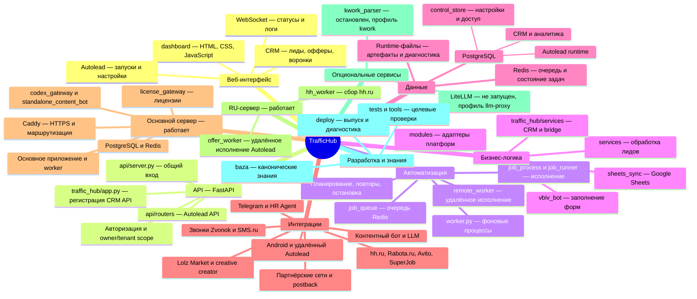

# Карта проекта

## Что это

`TrafficHub` — серверный продукт с веб-интерфейсом, API, фоновыми worker-задачами,
PostgreSQL, Redis и интеграциями. Данные и настройки изолируются по owner/tenant.

## Главные части

| Часть | За что отвечает | Где читать |
|---|---|---|
| Интерфейс и API | вход, dashboard, авторизация | [[02_Код/Код/Фронтенд]], [[02_Код/Архитектура/API]] |
| Бизнес-логика | лиды, офферы, интеграции | [[02_Код/Код/Бэкенд]], [[02_Код/Архитектура/Бизнес-логика]] |
| Фоновые задачи | очереди, full-cycle, расписание | [[02_Код/Эксплуатация/Воркеры и расписание]] |
| Данные | PostgreSQL, миграции, tenant scope | [[02_Код/База данных/Схема]], [[02_Код/База данных/Миграции]] |
| Сервер | контейнеры, логи, deploy | [[02_Код/Эксплуатация/Конфигурация]], [[02_Код/Эксплуатация/Развёртывание]] |
| Проверка качества | тесты и smoke | [[02_Код/Тестирование/Стратегия]] |

## Подтверждённые ориентиры

- Канонический product repo находится на сервере: `/root/TrafficHub`.
- `/app` внутри контейнера показывает запущенный код, но не является репозиторием.
- Production storage для основных контуров — PostgreSQL-first; SQLite остаётся в
  legacy, compatibility и test-слоях. Детали: [[04_План/Разработка/Технический долг]].

## Следующий шаг

### Подключения источников — актуально 2026-10-16

HH и Работа.ру используют общий encrypted owner/provider/connection repository,
check/refresh/disconnect и safe errors. Сетевой обмен только через RU, без originfallback.
RUleased credentials только в памяти. Подробности [[02_Код/Архитектура/Интеграции]].

## Майнд-карта внутреннего устройства — 2026-10-15

Проверено непосредственно на основном сервере `/root/TrafficHub`, HEAD
`95d59e9fe34d4cea56bd000fb47bbd6f9ea24239`, и RU-сервере 2026-10-15.
SSH HTTPS relay обрывал некоторые сессии; прямой SSH с тем же alias/principal
(`ssh -o ProxyCommand=none traffichub-live`) работает. Read-only `sudo -n`
позволил выполнить Compose без раскрытия `.env`. Локальный checkout не является
источником этой обновлённой карты. Рабочее дерево сервера содержит изменения,
поэтому HEAD не описывает весь runtime; app и worker используют разные образы.

Типовой путь: dashboard → API → проверка owner → очередь Redis → worker →
job_process/job_runner → локальное исполнение либо подписанная задача RU executor →
адаптер платформы → результат на основной сервер → PostgreSQL → API/WebSocket → dashboard.
Обычные чтения и CRUD могут идти напрямую из API в PostgreSQL, без worker.
RU executor не получает прямой доступ к Redis/PostgreSQL: код
`traffic_hub/services/remote_autolead.py` задаёт ограниченный подписанный API.
`REMOTE_AUTOLEAD_ENABLED=true` подтверждён в app и worker; выбор владельцев
определяется отдельно, нельзя считать включение глобальным для каждого пользователя.

На основном сервере восемь работающих сервисов Compose, все healthy:
`autolead_bot`, `worker`, `postgres`, `redis`, `license_gateway`, `caddy`,
`codex_gateway`, `standalone_content_bot`. `/api/health` вернул `status=ok`,
`control.backend=postgres`. На RU `traffichub_offer_worker` и `traffichub_hh_worker`
healthy, команды — `traffic_hub.remote_worker` и `traffic_hub.hh_ru_worker`.
AccountManager, operator_crm и отдельные license_auth/license_server не являются
отдельными контейнерами текущего стека; license_gateway запускает лицензионный контур.
SQL-запрос только имён таблиц подтвердил CRM, `autolead_*`, `control_*`, `hr_agent_*`.

Доказательства: серверные `/root/TrafficHub/api/server.py:423` и `:524`,
`/root/TrafficHub/traffic_hub/app.py`, `traffic_hub/worker.py:120`,
`traffic_hub/services/job_runner.py:224`, `traffic_hub/services/remote_autolead.py`,
`docker-compose.yml`, `deploy/Caddyfile`, `docker ps`, `docker inspect`,
`docker compose config --services/--profiles`, health и read-only список таблиц PostgreSQL.
Сохранённый вывод:
`C:/Users/admin/Desktop/Project/outputs/architecture-map-20261015/server-evidence.txt`.
Историческую [[02_Код/Архитектура/Карта контейнеров и модулей]] от 2026-07-17
нельзя использовать как текущий перечень контейнеров без новой runtime-проверки.

Для текущей ситуации откройте [[01_Сейчас/Что происходит сейчас]]. Для
архитектурного вопроса начинайте с [[02_Код/Архитектура/Обзор системы]].

## Контейнеры — runtime проверка 2026-10-16

Origin:8TrafficHubконтейнеровhealthy:app(traffichub-offers-fast-save:20261016),
worker(traffichub-parallel-stop-worker:20261016),Caddy,PostgreSQL16,Redis7,
license_gateway,codex_gateway,standalone_content_bot. Дополнительноvpn-xrayrunning,
неосновнойTrafficHubсервис. RU:offer_worker(traffichub-ru-elastic:20261016) и
hh_worker(traffichub-ru-source-credentials-hh:20261015),обаhealthy.
НаRUтакже5контейнеровFocusGroup,отдельныйпроект:app,caddy,sandbox,website,finance.
Проверкаdockerps/inspect16.10.2026;runtimeисточникприоритетнееисторическихimagesвыше.

